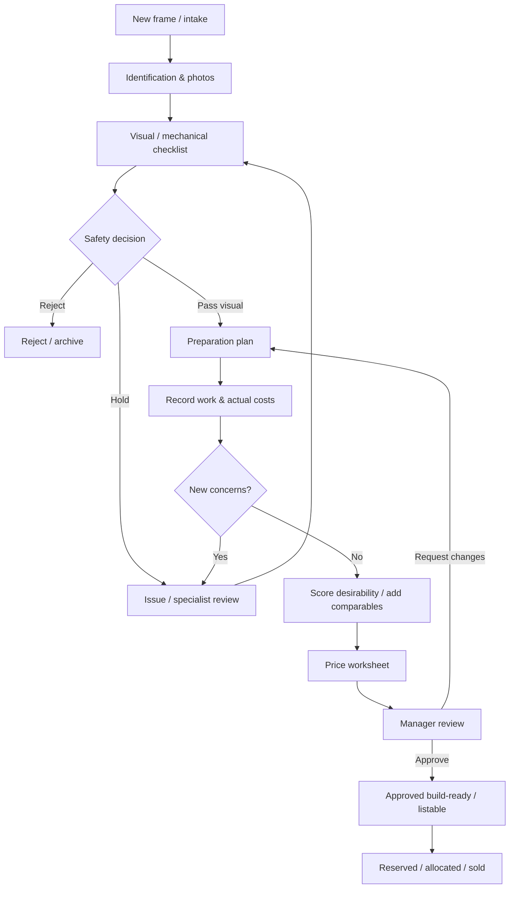

# BICII Frame Atlas
## Frame intake, inspection, preservation, grading and pricing

**Product requirements and build brief for Cursor**  
**Version:** 1.0, 16 November 2026  
**Status:** Specification only; this is a separate application and has not been implemented.

---

## 0. Copy-paste prompt for Cursor

> Build a standalone, mobile-first internal web application named **BICII Frame Atlas** for a small bicycle workshop in Singapore. Its job is to intake and identify old bicycle frames, document condition with photographs, support an honest professional visual inspection, plan and record preservation work, classify historical/market desirability, calculate actual prepared cost, recommend a defensible retail price, and generate a customer-facing frame history and specification sheet.
>
> **Crucial design constraints:** A frame’s **safety status**, **preservation-work level**, and **retail/desirability class** must be three different things. Never convert a price grade or cosmetic condition into a statement of structural soundness. Any frame with unresolved safety concerns must be blocked from an “approved for build / ready to sell” status. The application must not claim X-ray, ultrasound or any other non-destructive testing unless it was actually done and documented. A visual inspection cannot rule out all hidden defects. All suggested prices require human approval.
>
> Use **Next.js App Router, TypeScript, PostgreSQL via Supabase**, a responsive utility-first UI, photo storage, row-level security and auditable history. This is a *new*, separate repository: do not modify the existing BICII site or workshop system. Integrations and storefront synchronisation are future phases. Implement clear migrations, seed/test data, documented environment variables, validation, role-based permissions, tests and deployment instructions. Start with the MVP below. If the workspace already contains a compatible scaffold, inspect it before installing or replacing anything. Do not invent product inventory or safety test results. Ask only about credentials or deployment choices that cannot safely be assumed; otherwise use well-documented local defaults.
>
> Deliver an actual runnable application and README, not only mockups or a plan. Work incrementally: schema → auth → intake → inspection → preparation → grading/pricing → approvals → printable/exportable record → tests.

---

## 1. Why BICII needs this

BICII is a workshop and cycling community that sources vintage/second-hand bicycle frames from collectors, online listings, old bikes and other channels. The underlying frame is the primary product. Each frame may become the basis of a dependable Basic build or a high-end custom build; its age or collectibility is not equivalent to its mechanical suitability.

BICII wants to preserve the frame’s story, not erase it. Work often includes a complete strip-down, degreasing, visual inspection, removal or treatment of surface corrosion, steel-tube internal corrosion protection where appropriate, and preserving/touching up original paint. More elaborate polishing, cosmetic patina treatment or kintsugi-inspired work is optional and separate. Typical *initial* work is estimated at 3–4 hours per frame, but the system must use actual recorded work, not assume every frame takes the same time.

The user problem is inconsistent pricing. A name-brand 1990s chromoly frame may be worth S$500–600 to BICII after preservation, while an unrecognised but well-made aluminium frame could start around S$200. Prices must reflect both marketplace desirability and BICII’s actual work/cost—not simply acquisition price, material, or a subjective sticker grade.

## 2. Outcomes

1. A standard frame-intake record in under 10 minutes, photos included.
2. A reproducible inspection with a mandatory safety decision and evidence.
3. A documented preparation plan, time estimate, actual hours, consumables and external services.
4. A transparent classification for historical/commercial desirability with confidence and rationale.
5. A suggested retail price based on cost floor, comparables, frame class, completeness and human judgement.
6. A reviewer-approved listing dossier customers can understand.
7. Searchable inventory history and an audit trail for every change.

**Out of scope for MVP:** automatic structural certification, AI crack detection, auto valuation from image recognition, automated scraping of Carousell, guaranteed market pricing, online retail checkout, parts inventory integration, a full service/work-order system, real-time Shopify sync or financial accounting. Build extension points, not fake features.

## 3. Product principles

- **Three separate axes, always:** (A) structural readiness, (B) preservation effort/condition, (C) historical/commercial desirability. Never combine into one “quality” grade.
- **Evidence over assumption:** unknown is an allowed and expected value. Do not infer exact model/year/tubing from paint or serial alone.
- **Human approval:** scoring is decision support, not a market oracle. Staff can override with a written reason and review identity.
- **Repeatability:** staff using the same evidence should arrive at comparable recommendations.
- **Safety gate:** serious suspected issues cause **HOLD** or **REJECT**. Lower prices do not make an unsafe frame acceptable.
- **No fake measurements:** support both qualitative checks and measured mm/dimensions, with who measured and when.
- **Explainable pricing:** show how many SGD come from acquisition, time, materials, overhead, optional external services and target margin.
- **Customer clarity:** history, work done, what is included and inspection limitations travel with the frame.

---

## 4. A. Structural/functional assessment — separate from price

### Allowed outcomes

| Outcome | Meaning | What the system permits |
|---|---|---|
| `DRAFT` | Intake or inspection incomplete | No approval or publication |
| `PASS_VISUAL` | Trained staff completed the visual/mechanical checklist with no unresolved concerns | Can move to preparation and, after review, build-ready |
| `HOLD` | Question, suspected structural problem, inadequate evidence, measurements outstanding, or specialist review required | No build-ready/publish |
| `REJECT` | Unsafe, not economically/technically suitable, or explicitly rejected by a qualified reviewer | No build-ready/publish; archive for parts/display if applicable |

Use the user-facing phrase **“Passed BICII’s documented visual/mechanical inspection on [date]”**, never “crack-free guaranteed,” “certified safe,” or “X-rayed.” A pass is a historical observation, not a permanent guarantee. Reinspection may be required after new damage or long storage.

### Required checklist groups

**Identification and provenance**
- Manufacturer name, model, estimated era/year; how known and confidence: confirmed/likely/unknown.
- Material (steel/aluminium/carbon/titanium/other/unknown), how determined; tubing decal/source evidence.
- Serial or stamped markings, location, readable photo, privacy if customer supplied.
- Acquisition source and seller, purchase documentation where available.
- What is included: bare frame, matching fork, non-matching fork, headset, bottom bracket or other components.

**Frame structure, visually inspected**
- Cracks or suspect lines at visible joints, welds, lugs, brazes, head tube, down tube, seat cluster, bottom bracket and rear triangle.
- Dents, bends, kinks, deformation, tube damage and previous repairs.
- Fork steerer and crown/dropouts if a fork is included; distinguish unsupported fork assessment if not included.
- Dropouts, hanger alignment/condition where assessable, brake bosses/tabs, rack and bottle bosses.
- Corrosion, paint blistering, pitting, evidence of severe internal corrosion, seized interfaces.
- Aluminium-specific checks of weld zones, dents, corrosion and stressed interfaces.
- Steel-specific checks of tubing corrosion, brazed/lugged joints, threaded interfaces and accessible interior condition.
- Carbon-specific damage/debonding/impact concerns trigger specialist assessment; no assumption visual checks are sufficient.
- Changes from original construction including welded disc tabs or geometry/fork conversion; capture who performed them and whether they require specialist review.

**Compatibility and serviceability**
- Head tube/steerer headset standard and condition; actual measured diameters.
- Bottom bracket shell width, thread/press-fit type and condition.
- Rear dropout spacing (OLD), axle/QR/thru-axle compatibility and alignment when measured.
- Wheel diameter and tyre clearance, and brake reach/boss placement.
- Brake mount type, routing, derailleur hanger type; drivetrain limitations.
- Seat tube/seatpost internal diameter, minimum insertion issues, clamp condition.
- Frame size (seat tube, top tube etc.), standover/reach where measured.
- Rack/fender/other mounting options.
- All measurements may be unknown until checked; a generic frame model lookup never overrides physical measurements.

### Evidence requirements

At least photos of: full drive side, full non-drive side, head tube/front joints, bottom bracket area, seat cluster, rear dropouts, serial, damaged/treated areas and included fork. For inaccessible areas, record “not inspected” and why. Allow more photos and notes.

Each checklist item: `result = pass | concern | not_applicable | not_inspected`, notes, optional linked image IDs, inspector and timestamp. A `concern` on a structural item immediately places the record on HOLD unless reviewer explicitly resolves it with documented rationale. A `not_inspected` on mandatory item blocks approval.

**Safety implementation invariant:** `available_for_build` requires a completed PASS_VISUAL assessment by an authorised inspector, no unresolved critical flags, preparation release and reviewer approval.

---

## 5. B. Preservation work — not a collectible grade

Use codes to plan and measure effort, not to determine how “good” or “premium” a frame is.

| Code | Typical work | Initial planning range |
|---|---|---:|
| `P1` Light | Degrease, inspect, careful cleaning, very minor touch-ups | 1–2 hours |
| `P2` Standard | Full strip-down, thorough cleaning, corrosion assessment/protection, finish preservation | 2–4 hours |
| `P3` Extensive | Seized parts, substantial surface rehabilitation, detailed cosmetic conservation, extra interventions | 4–7 hours |
| `P4` Specialist | Unusual treatments, outsourced services, specialist finish or research | Individually scoped/quoted |

**P-levels are estimates**; actual time logs control costs. “P3” does not mean lower structural quality. Some collectible frames need P1; some common frames need P3. If treatment reveals an issue, return to HOLD and reinspect.

### Work operations

- Strip/disassemble, clean/degrease, remove old decals only when justified, remove accessible corrosion, rust converter where appropriate, exterior protection, internal steel protection where compatible and applied correctly, paint touch-up, polish, cosmetic kintsugi-inspired treatment, specialist services, reassembly/ready-to-build handoff, and other configurable tasks.
- Every operation records status, estimated hours, actual hours, person, material, cost, before/after photos, notes and date.
- **Cosmetic kintsugi-inspired work is never described as a structural repair.**
- Corrosion resistance differs by metal and finish; record actual procedure, product if used and any caveats rather than showing a misleading “rust-proof forever” badge.
- A frame may be retained with visible patina and still pass inspection. Cosmetic condition, original paint and patina are independent labels.

### Condition descriptor (separate field)

- `original_excellent`
- `original_worn_patina`
- `original_heavy_cosmetic_wear`
- `retouched_conserved`
- `repainted_refinished`
- `unknown`

Store descriptive notes and photographs, not a disguised safety score. Original paint and documented patina may support collector appeal depending on specific market evidence.

---

## 6. C. Historical/commercial desirability class

The five classes below are **price/market-position guides**, not quality, strength, prestige or safety grades. Assign only after identification, market evidence and reviewer approval.

| Class | Website name | Initial guide price in SGD, prepared frame/frameset as actually specified |
|---|---|---:|
| `F1` | Found Gems | S$200–349 |
| `F2` | Everyday Classics | S$350–499 |
| `F3` | Heritage | S$500–699 |
| `F4` | Sought After | S$700–999 |
| `F5` | Collector | S$1,000+ |

**Do not hardcode material → class.** Steel, aluminium, carbon and titanium are all possible in different categories if the specific construction, condition, evidence, rarity and demand support it. Fork inclusion must appear explicitly on quotes and comparables.

### Proposed scoring rubric, 0–100 points

| Dimension | Max | Guideline |
|---|---:|---|
| Manufacturer/maker provenance and reputation for this era | 15 | Quality/evidence about actual maker, including credible white-label attribution |
| Specific model historical relevance | 20 | Was this frame/model notable, distinctive or influential? |
| Verified tubing/construction/design interest | 20 | Actual tubing/construction, not generic steel/aluminium bias |
| Relative scarcity and difficulty of sourcing | 15 | Local/regional supply, original configuration, verified availability |
| Present buyer demand and market evidence | 20 | Actual comparable sales where possible; asking prices clearly labelled |
| Documented provenance, originality and completeness | 10 | Original fork/paint/markings, credible records, not invented backstory |
| **Total** | **100** | |

Suggested *initial* mapping: `F1=0–19`, `F2=20–39`, `F3=40–59`, `F4=60–79`, `F5=80–100`. **This mapping is a configurable starting hypothesis, not validated market science.** The app must show the score, the individual evidence and a confidence level, and let a reviewer assign a different class with explanation. Calibrate thresholds after comparing 15–20 real BICII frames.

**Unknown ≠ zero in every case.** Each dimension should have a `confidence` and `insufficient_evidence` flag; when data is insufficient, display an incomplete score/range and send to manual review. Never award positive provenance points based on a guess.

### Avoiding scoring traps

- An extremely well-made unbadged/white-label frame can score high in construction even if maker recognition is low.
- A common chromoly frame may sit in F2 or F3, depending on evidence and market, not automatically F3.
- A prestigious logo alone cannot overcome missing/contradictory identification.
- A cracked collector frame might be historically valuable for display but **cannot** be marked build-ready.
- A frame with a matching fork can command a different price from a bare frame. The app should compare like with like and flag missing fork comparability.

---

## 7. Valuation and selling-price calculation

Pricing combines **cost floor**, **market context**, and **class-based positioning**. Do not simply multiply acquisition by a factor or choose the midpoint of the F-band.

### Required inputs

- Acquisition price (SGD), acquisition shipping/transport, import fees if any.
- Preparation staff time by task, internal labour rate per person/task, actual or estimated.
- Materials and consumables consumed in frame preparation.
- Outsourced preservation/restoration fees.
- Allocated overhead per frame or cost allocation method, configurable and transparent.
- Expected sales/transaction fees (optional per channel; include when appropriate).
- Desired gross margin rate (configurable, default only if the owner selects it).
- Comparable listings/sales with dates, condition, included fork, country/currency, source link and *asking vs sold* distinction.
- Human assessment of market demand, scarcity and confidence.
- Currency conversion if comparables are not SGD: rate, date and source must be recorded; do not fetch or invent rates in offline mode.

### Formula and warning logic

```text
preparation_labor_cost = Σ (hours_i × actual_rate_i)
prepared_cost = acquisition + inbound_freight + preparation_labor_cost
              + materials + external_services + allocated_overhead
minimum_price_before_sales_fees = prepared_cost / (1 - target_gross_margin)

# If a channel fee applies to gross selling price, and target margin means
# margin after fee, use:
minimum_price_after_fee = prepared_cost / (1 - target_gross_margin - selling_fee_rate)
# Valid only if target_gross_margin + selling_fee_rate < 1.
```

The UI must label margin basis explicitly. Exclude GST from margin calculations where relevant and account for GST-inclusive retail display based on BICII's actual tax registration/status (must be configurable, not assumed). Show raw and rounded suggested prices, and explain price rounding.

### Decision rule, not an automatic sticker

1. Show **actual prepared cost** and **cost-floor price**.
2. Show **F-class price band** and what evidence supports it.
3. Show a **market-comparable range** (and its confidence) if sufficient quality comparables exist.
4. Suggest a retail price chosen by a configurable, explainable rule or by reviewer. A simple MVP proposal is the reviewer-selectable price rounded to S$10/50 within a reasoned interval—not an opaque ML model.
5. Flag **commercial conflict** when cost floor exceeds credible market price/band. This is a buying/preparation decision, not a reason to inflate market value silently.
6. Permit below-floor pricing only with authorised approval and explicit reason (e.g., educational build, strategic stock, mission pricing), and show the gross loss/margin clearly.
7. Lock an approved retail price version with `approved_by`, `approved_at` and `rationale`. Editing creates a new version.

### Worked example: hypothetical early-1990s Giant Yukon

This is a **test scenario**, not a claim about a specific physical frame or market sale. First confirm exact model/year, tubing, frame size, included fork and actual condition.

| Input | Example |
|---|---:|
| Acquisition | S$80 |
| Prep time | 3.5 hours |
| Editable internal labour rate | S$25/hour |
| Preparation labour cost | S$87.50 |
| Materials/treatments | S$25 |
| Allocated overhead | S$20 |
| **Prepared cost** | **S$212.50** |
| Illustrative gross-margin target | 40% |
| **Cost floor, before sales fees** | **S$354.17** |
| Potential value class | F2 or F3, subject to verification |
| Potential reviewed asking price | S$450–600 **only if comparables support it** |

At S$500 retail, the simplified frame gross margin is 57.5% before sales fees and any other omitted costs. At S$400 it is 46.875%. Display correct values, don't confuse mark-up with margin. Actual sales prices may be quite different.

### Test example: overlooked aluminium white-label frame

Acquire S$40; 2.0 hours at S$25; materials S$15; overhead S$15 → prepared cost S$120. At 40% gross margin, cost floor S$200. If evidence supports F1, price S$200–349. **No narrative that cheap means unsafe.**

---

## 8. Lifecycle and workflow



### Lifecycle status vocabulary

`intake_draft` → `identified` → `inspection_pending` → `hold` / `rejected` / `inspection_passed` → `preparation_planned` → `preparation_in_progress` → `ready_for_pricing` → `pricing_review` → `approved` → `listed` → `reserved` → `allocated_to_build` / `sold` / `archived`.

Statuses must be validated server-side; UI buttons cannot bypass transitions or auto-mark unsafe frames safe. If reinspection invalidates approval, remove listing eligibility immediately and preserve history.

### Core user journeys

1. **Intake:** photograph frame, assign unique `BICII-F-000001`-style human-readable ID, log source/cost, fork contents, basic ID; save draft offline if practical.
2. **Inspection:** complete structured checklist with flagged concerns, measurements, images, pass/hold/reject decision, responsible inspector/date.
3. **Preservation:** add tasks and estimates, record actual labour, chemicals/consumables, before/after images and any specialist work.
4. **Classification:** document identification evidence, score rubric dimensions, confidence and class.
5. **Valuation:** enter comparable data; review cost floor, class range and price conflicts; propose an actual retail price.
6. **Approval:** authorised reviewer signs off both inspection release and price, possibly in distinct steps.
7. **Listing:** generate a public-safe frame card / PDF / Markdown and a JSON or CSV export for later storefront upload.
8. **Inventory:** mark reserved, sold or allocated; archive, never erase history.

---

## 9. Data model (minimum tables/entities)

The following is a logical model; Cursor should normalise tables and implement migrations accordingly.

### `frames`
- UUID primary key; unique `frame_code` business ID.
- `brand_text`, `model_text`, `maker_text`, `estimated_year_from`, `estimated_year_to`, `year_confidence`, `material`, `material_confidence`, `tubing_claim`, `tubing_evidence`, `frame_size_label`, `serial_text` and `serial_location`.
- `frame_only_or_frameset`, `fork_included`, `fork_originality` and fork notes.
- `acquisition_source_type`, non-public source notes, seller identity with access controls, acquisition date/cost/currency, purchased/consigned/owned status.
- `cosmetic_condition`, `current_status`, `inspection_status`, `preservation_class`, `value_class`, `current_approved_price_sgd` optional, timestamps and owner.
- `public_story`: facts and owner-approved narrative, distinguishing verified from unknown.

### `frame_photos`
UUID, `frame_id`, storage path, photo type/category, before/after tag, caption, visibility internal/public, taken_at/by, checksum/version. Storage RLS. Remove serial/private seller identifiers from public exports when requested.

### `frame_measurements`
`frame_id`, `measurement_type`, numeric value, unit, measurement method, observed_by/time, uncertainty notes. Support mm and degrees; valid types configured separately.

### `inspections` and `inspection_items`
Versioned inspection, inspector, type (`visual_mechanical` default), performed_at, outcome, notes, critical_flags, approval signature. Item category/check ID, result, notes, evidence-photo IDs. Keep version history; never modify a historical pass record in place.

### `preservation_work_orders` and `preservation_tasks`
Work order statuses, planning P-class, task type, description, estimate and actual hours, internal rate, cost, materials, operator, before/after photos, completion dates, issues discovered.

### `cost_items`
Frame ID, category (`acquisition`, `freight`, `labor`, `materials`, `overhead`, `external`), amount, currency, source, related task, transaction date, inclusion in cost basis, created/updated by. Avoid double-counting task costs.

### `desirability_assessments` and `assessment_scores`
Scoring version, dimension scores, evidence, confidence, calculated total, proposed class, approved class, reason for overrides, assessor/reviewer and dates.

### `market_comps`
